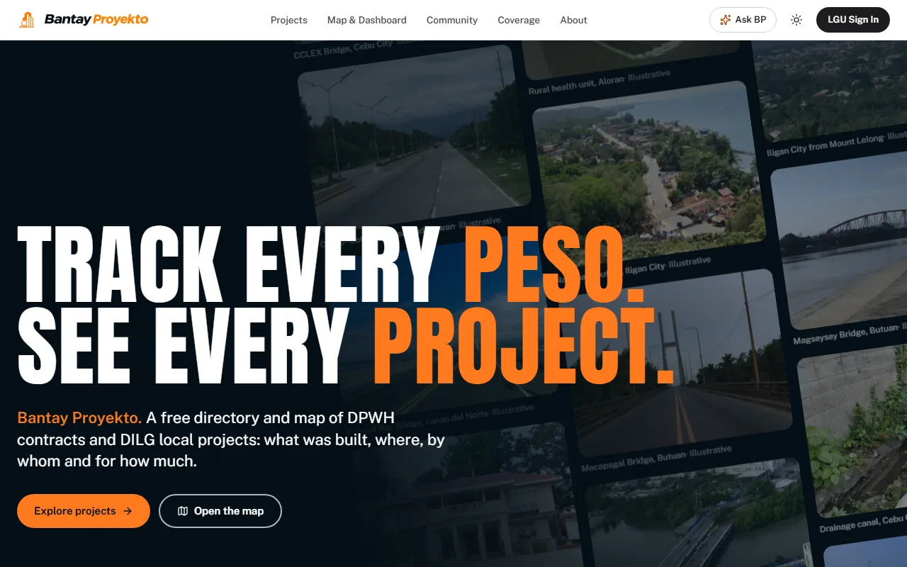
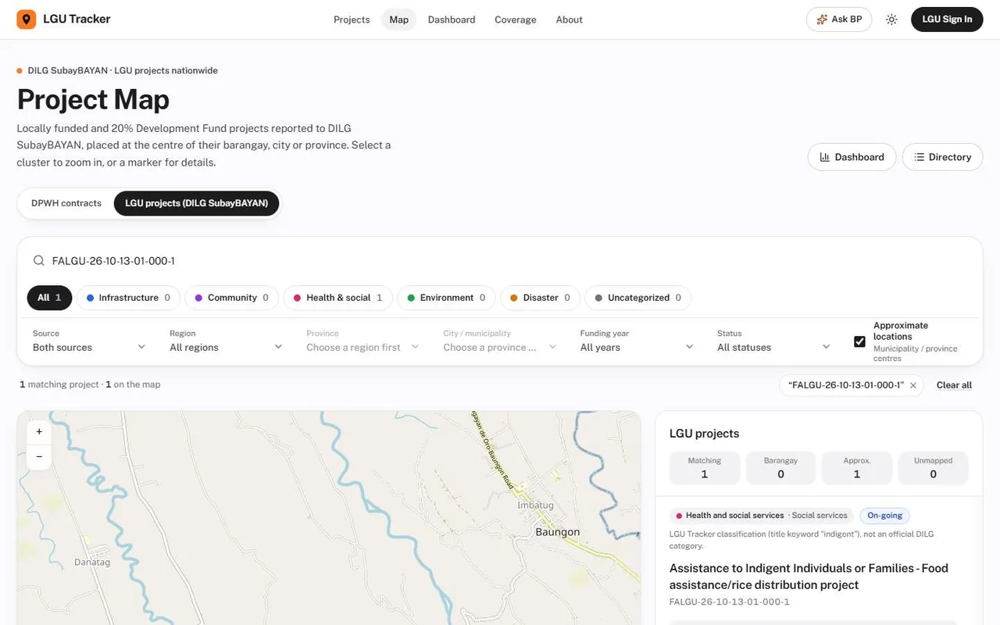
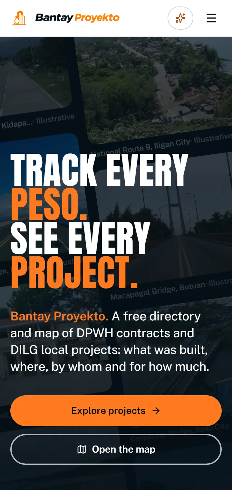

<p align="center">
  <picture>
    <source media="(prefers-color-scheme: dark)" srcset="public/brand/lockup-horizontal-on-dark.png">
    
  </picture>
</p>

# 🏗️ LGU Tracker

### *Bantay Proyekto, Gabay sa Progreso.* 🇵🇭

> 🚧 **Under active development.** Features and data are changing; see [Project status](#-project-status).

**LGU Tracker** is a free public directory and map of Philippine infrastructure projects: DPWH contracts and
DILG-reported local government projects. For each project it shows what was built, where, by whom and for how
much, and links back to where the record was published. Signed-in people can also discuss projects in a public
community, send concerns to LGU staff and follow what happens to them.

<picture>
  <source media="(prefers-color-scheme: dark)" srcset="docs/images/landing-dark.webp">
  
</picture>

---

## ✨ Features

### Landing page with live stats
Record counts, a region breakdown and a dot map of contract locations, read live from cached aggregates in the
database.
On a first visit, an intro animation counts up from 0 to 100%.


### Project directory
One searchable list of more than 175,000 records with an **All / DPWH / DILG** agency switch, DILG categories, filters, sort,
and grid or table views.


### Project map
- **Map and dashboard on one page**: the dashboard sits above the map, and both share one set of region, status and
  category filters. Choosing a region on the dashboard zooms the map to it; filtering the map updates the charts.
  Marker colours follow the dashboard (by region, status or category), and the map stays within the Philippines.
- **DPWH layer**: contracts at the coordinates DPWH reports. In view, it shows up to the 2,000 largest contracts.
  Responses are cached, so panning and filtering stay quick.
- **LGU layer (DILG SubayBAYAN)**: 41,194 projects in clustered markers (supercluster), with category chips and
  source, region, province, city, year and status filters.
- **Approximate locations**: SubayBAYAN has no coordinates, so each project sits at the centre of its barangay,
  city or province. The panel says which one. An *Approximate locations* toggle shows or hides projects placed at a
  city or province centre.
- **Street View cat**: drag it onto the map to see the street there.


### Jump to a project by SubayBAYAN code
`/projects/map?code=FALGU-26-10-13-01-000-1` opens the LGU layer and zooms to that project. If several projects
share a code, it lists them all.



### Project detail pages
Every DPWH contract, NEP item and DILG project has its own page with the reported fields and a link to its source
(for BetterGov.ph data, the exact dataset file and revision).

### Dashboard
DPWH contracts by region, status, category and year, with a region filter. It is part of the Map & Dashboard page
(above), so the numbers and the map always describe the same selection. FY 2027 NEP proposals are counted
separately.


### Community
A public discussion board about projects, at `/community`. Anyone can read; an account is needed to post, comment
and vote.
- **Discussions, replies and votes** that update live for everyone on the page.
- **Link a discussion to a project**, with suggestions as you type.
- **Post or comment anonymously.** An anonymous item stores no name, photo or role in the public row. Only the
  author and administrators can see who wrote it.
- **Role pills.** A small coloured tag beside a name: **Super Admin** (purple), **Admin** (red), **LGU** (green) for
  government staff. Citizens, contractors and anonymous items have none. Admins can recolour or rename these, and
  give themselves a custom pill from their profile. A change shows everywhere at once.
- Rate limits on posting and commenting, and each person can delete their own items.

### Report a concern
Anyone signed in can send a concern about a project at `/report`, with photos. Each report gets a short number
(like `RPT-00042`) and a status the sender can follow: **Sent → Received → In review → Resolved / Closed**.
- **My reports**: your own reports and their timeline. Only you and LGU staff can see them.
- **Report queue** (staff): open a report, change its status and write back to the sender.
- **Inbox**: a notification when your report moves, when your role changes, or when something needs your attention.

### Accounts, profiles and roles
- **Sign-up and sign-in**, with a sign-in dialog available from any page.
- **Four roles people see**: Super Admin, Admin, Government Employee and Citizen. Everyone starts as a citizen;
  asking for a role at sign-up puts the account in a queue until an administrator decides. Access is enforced in the
  database (Row Level Security), not only in the interface.
- **Users and roles** (administrators): approve or change roles. Only a Super Admin can manage administrator accounts.
- **Profile**: your name, job title and a picture: upload a photo (cropped to a square first) or pick a free avatar.
  Administrators also manage role pills here.
- **Monitoring workspace** (`/dashboard`) with a sidebar for staff tools, pinned to the left of every signed-in page.

### Ratings on the landing page
Signed-in people can leave one 1–5 star rating with a short review (optionally first name only). Reviews show on the landing page and update live; administrators can hide one.

### Ask BP assistant
A chat assistant for questions about the directory, built on Groq tool calling (free tier). The model never writes SQL.
It can only call two read-only tools, and the counts in its answers come from the database. See
[`docs/BP_ASSISTANT.md`](docs/BP_ASSISTANT.md).


### Dark mode and mobile
Light, dark or system theme, with layouts down to 360 px wide.



---

## 📚 Data sources

| Data | Source | Retrieved | License / terms |
|---|---|---|---|
| DPWH contracts (Visayas, Mindanao, Metro Manila, Central Luzon, CALABARZON) | DPWH Transparency Portal via [BetterGov.ph](https://huggingface.co/datasets/bettergovph/dpwh-transparency-data) | Oct 26, 2026 (import incomplete) | CC0 1.0 |
| DPWH FY 2027 NEP proposals (nationwide, directory only, no coordinates) | [BetterGov.ph](https://huggingface.co/datasets/bettergovph/dpwh-nep-2027) | with the DPWH data | Not stated; the NEP is a public government document |
| LGU projects: Locally Funded Projects (LGSF) | [DILG SubayBAYAN (RBME)](https://subaybayan.dilg.gov.ph/rbme/projects/index?type=lgsf) | Oct 31, 2026 (Excel export snapshot) | Public government records (DILG) |
| LGU projects: LIME 20% Development Fund (RLIP) | [DILG SubayBAYAN (RBME)](https://subaybayan.dilg.gov.ph/rbme/projects/index?type=rlip) | Oct 31, 2026 (Excel export snapshot) | Public government records (DILG) |
| Boundaries (centroids for LGU projects) | NAMRIA / PSA via [OCHA COD-AB](https://data.humdata.org/dataset/cod-ab-phl), packaged by [faeldon/philippines-json-maps](https://github.com/faeldon/philippines-json-maps) v1.1.0 (PSGC 3Q 2026) | pinned by SHA-256 | CC BY-IGO (packaging: MIT) |
| Base map | © [OpenStreetMap](https://www.openstreetmap.org/copyright) contributors | live tiles | ODbL |

All values are shown as each source published them; the LGU has not verified them. Photo credits and licenses
are on the app's `/credits` page ([source](src/app/credits/page.tsx)).

---

## 🛠️ Tech stack

| Technology | Purpose |
|---|---|
| Next.js 16 (App Router) · React 19 · TypeScript | Web app |
| Tailwind CSS v4 | Styling, light and dark themes |
| Supabase (Postgres, Auth, Storage, Realtime, Row Level Security) | Database, accounts, profile photos and report photos, live community, public read access |
| Leaflet + supercluster | Maps and marker clustering |
| motion | Landing page animation |
| Groq API (plain `fetch`, no SDK) | Ask BP assistant |
| Vercel | Hosting |

---

## 🚀 Getting started

**Prerequisites:** Node.js 22 or later, and a Supabase project with the migrations in `supabase/migrations`
applied (`supabase db push`).

```bash
git clone https://github.com/sirikitmac/lgu-tracker.git
cd lgu-tracker
npm install
cp .env.example .env.local   # then fill in the values
npm run dev                  # http://localhost:3000
```

`.env.example` explains every variable. The main ones:

| Variable | Needed for |
|---|---|
| `NEXT_PUBLIC_SUPABASE_URL`, `NEXT_PUBLIC_SUPABASE_PUBLISHABLE_KEY` (or `..._ANON_KEY`) | Reading data |
| `SUPABASE_SECRET_KEY` | Server-only: data sync and import scripts |
| `CRON_SECRET` | Server-only: the scheduled sync route |
| `GROQ_API_KEY` (optional `GROQ_MODEL`, `GROQ_FALLBACK_MODEL`) | Server-only: Ask BP (without it, dev shows a labelled non-AI preview) |
| `GOOGLE_MAPS_API_KEY`, `NEXT_PUBLIC_GOOGLE_MAPS_EMBED_KEY` | Optional: in-map Street View |

Never commit `.env.local` or put a secret key in a `NEXT_PUBLIC_` variable.

```bash
npm test          # unit tests (DPWH, BetterGov, BP, SubayBAYAN, reports, auth, community, reviews)
npm run test:db   # database tests against an in-memory Postgres (PGlite): the migrations, row-level
                  # security, roles, reports, community, anonymous posts and role pills
npm run lint      # TypeScript type check (tsc --noEmit)
npm run build     # production build
```

### Data pipelines

- **DPWH:** `npm run dpwh:sync`. Setup and the Vercel cron are in [`docs/DPWH_DEPLOYMENT.md`](docs/DPWH_DEPLOYMENT.md).
  The sync stops before the database passes `SYNC_STORAGE_BUDGET_MB` (default 400), which is why the Luzon import
  is partial on the free Supabase plan.
- **Sample reports:** [`docs/mock-reports.md`](docs/mock-reports.md) loads sample reports to try My reports, the queue and the inbox.
- **DILG SubayBAYAN:** a one-time Excel export, since the portal needs a sign-in. The app never contacts the portal.

```bash
npm run subaybayan:build    # Excel → normalized, categorized, located rows + docs/subaybayan/report.md
npm run subaybayan:dedupe   # flag possible DPWH duplicates (read-only)
npm run subaybayan:import -- --dry-run   # preview; then --limit 100; then no flags for everything
```

- `build` reads `<source>/Locally_Funded_Projects/*.xlsx` and `<source>/LIME_20DF/*.xlsx`. `<source>` defaults to
  `~/Downloads/SubayBayan_RBME`; change it with `SUBAYBAYAN_SOURCE_DIR` or `--source`. Boundaries are cached in
  `.cache/subaybayan` and checked by SHA-256.
- `import` needs migration `20261103000100` and `SUPABASE_SECRET_KEY`. It upserts in batches of 1,000 and skips
  unchanged rows. It stops before the database passes `SYNC_STORAGE_BUDGET_MB` (default 400).
- Categories (infrastructure, community, health and social, environment, disaster) are **LGU Tracker's own keyword
  classification**, not DILG's. Where a reported total cost is over 20× the row's own contract amount or subsidy,
  the map shows the smaller amount and keeps the original in `total_cost_reported`.
- Possible DPWH duplicates go into `subaybayan_dpwh_matches` as review flags. Records are never merged.
- Figures and known gaps: [`docs/subaybayan/report.md`](docs/subaybayan/report.md) ·
  [`docs/subaybayan/duplicates.md`](docs/subaybayan/duplicates.md).

---

## 🗂️ Project structure

```
src/
  app/            routes: / (landing), /projects, /projects/map (Map & Dashboard), /projects/[contractId],
                  /projects/source/..., /community, /report, /credits, /login, /register, /dashboard,
                  (app)/ inbox, my-reports, reports, users, profile; api/
  components/     landing/, dpwh/, subaybayan/, map/, bp/, community/, reports/, reviews/, notifications/,
                  profile/, badges/, users/, workspace/, auth/, layout/, dashboard/, ui/
  lib/            supabase/, integrations/ (dpwh, bettergov), dpwh/, subaybayan/, bp/, auth/, actions/,
                  community/, reports/, reviews/, notifications/, badges/, profile/
scripts/          dpwh-sync, bettergov-sync, subaybayan/ (build, dedupe, import), reports-import
supabase/         migrations/ (28), seed.sql
tests/            dpwh/, bettergov/, bp/, subaybayan/, reports/, auth/, community/, reviews/, notifications/,
                  sources/, db/
docs/             BP_ASSISTANT.md, DPWH_DEPLOYMENT.md, mock-reports.md, subaybayan/, images/
```

---

## 🛣️ Coming soon

Planned, or partly built but not working end to end yet:

- 🌏 **Complete Luzon coverage.** Metro Manila, Central Luzon and CALABARZON are in, but the import stopped at the
  free-plan storage budget, so those three regions are partial. Finishing it needs more database space.
- 🗺️ **Every dot on the map by default.** Wide views show a sample of up to 2,000 projects (largest first). Showing
  everything needs server-side clustering.
- 🔄 **Automated weekly DPWH sync.** The cron route and schedule are written, but it has not run in production yet.
- 💬 **Public feedback on a project page.** Discussions and reports exist; comments directly on a project do not.
- 🔍 **Review tool for possible DPWH–DILG duplicates.** The flags are stored; there is no review screen.
- 📍 **Exact barangay-level locations** from geotagged photos, with the owners' permission.
- ⚡ **Faster directory sorts.** Some non-default sorts time out on the full dataset.
- 🗓️ **Scheduled SubayBAYAN refresh.**

---

## 📌 Project status

🚧 **Under development.** Features and data may change. The data is a snapshot from the dates above, not a live
feed. LGU Tracker is a student project, not an official government website.

| Area | Status |
|---|---|
| Public directory, project pages, search and filters | ✅ Working |
| Map & Dashboard (shared filters, DPWH and LGU layers) | ✅ Working |
| Ask BP assistant | ✅ Working (needs a Groq key) |
| Accounts, roles, profiles, role pills | ✅ Working |
| Community (live, anonymous posting, votes) | ✅ Working |
| Reports, report queue and inbox | ✅ Working |
| DPWH data: Visayas, Mindanao | ✅ Imported |
| DPWH data: Metro Manila, Central Luzon, CALABARZON | 🟡 Partial (storage limit) |
| Scheduled data refresh | 🟡 Written, not yet running in production |
| Duplicate review, exact locations | ⏳ Planned |

---

## 👥 Contributing

Bug reports, suggestions and pull requests are welcome. Work on a feature branch, run `npm test`, `npm run lint`
and `npm run build` before opening a PR, and talk to the maintainers before making large changes.

**CCC181 Final Project by Team BB (BeyondBoard).**

---

**LGU Tracker — Bantay Proyekto, Gabay sa Progreso.** 🇵🇭
