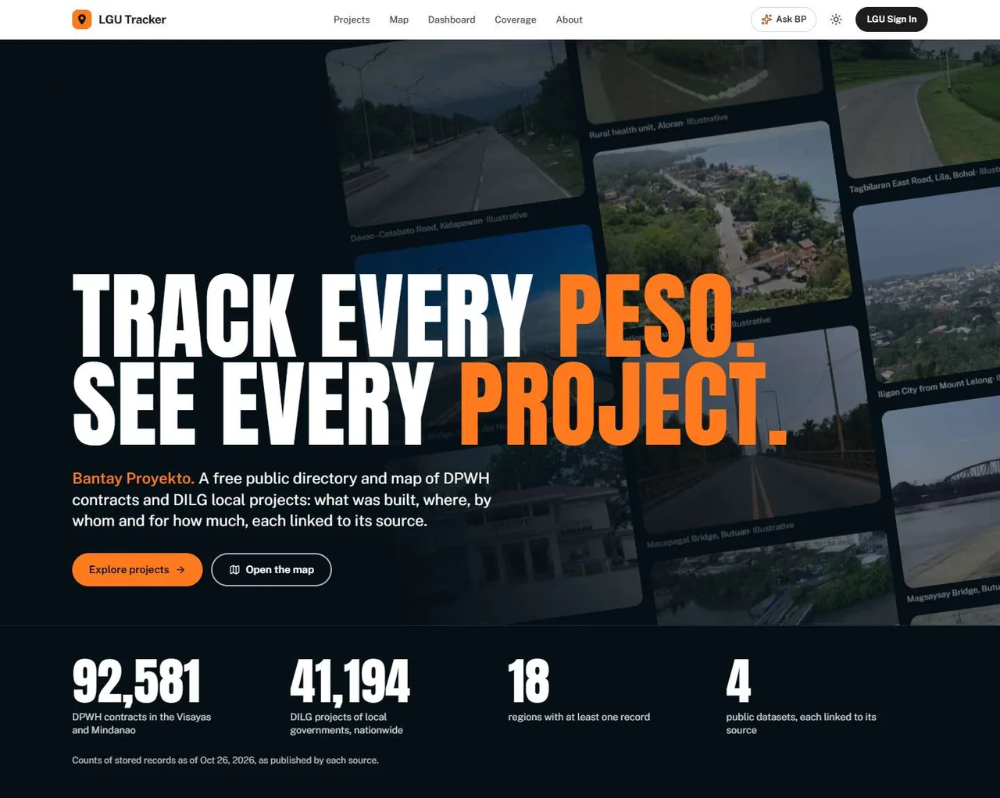
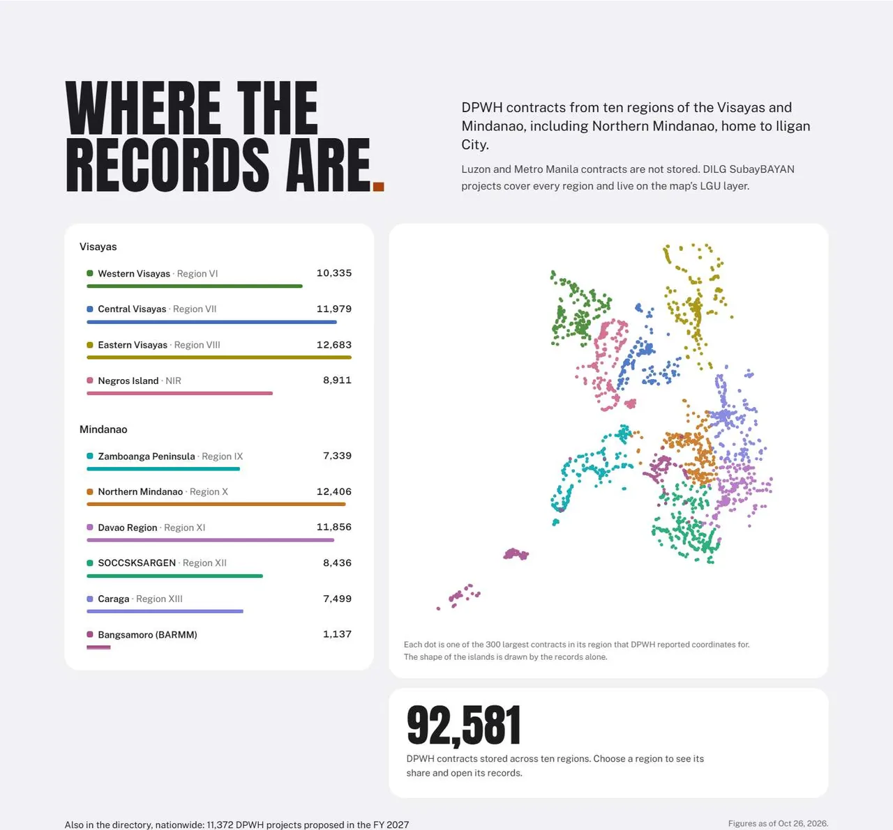
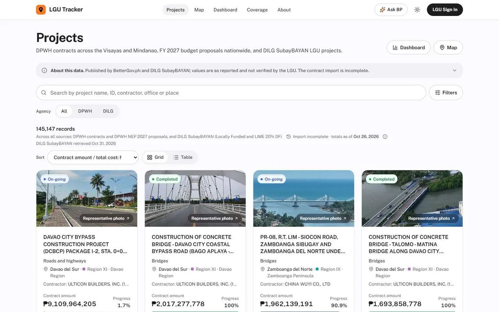
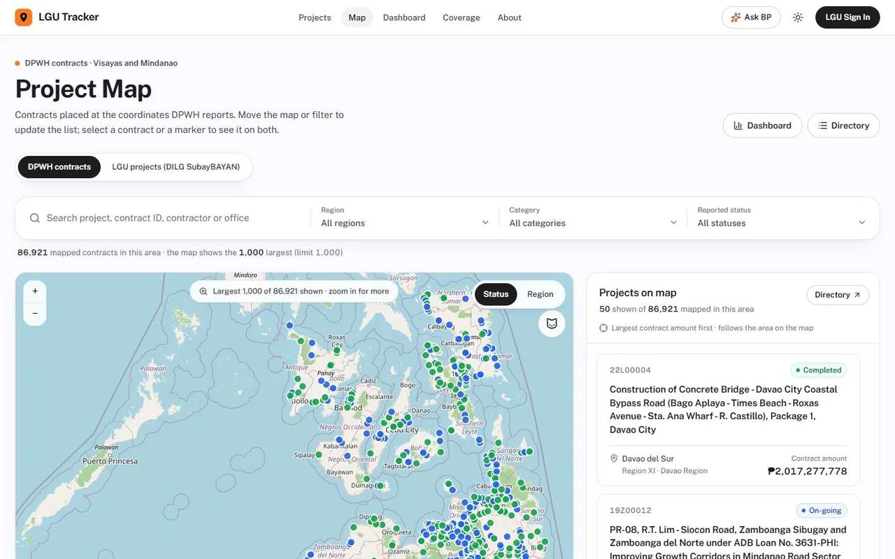
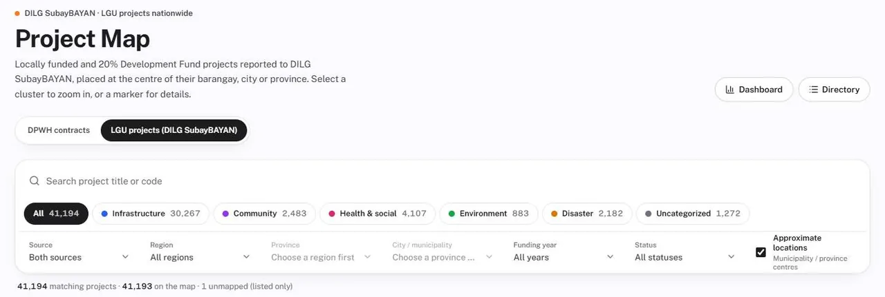
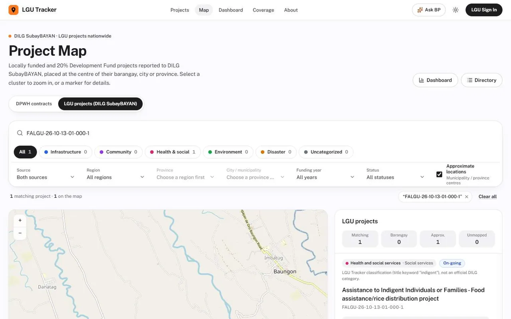
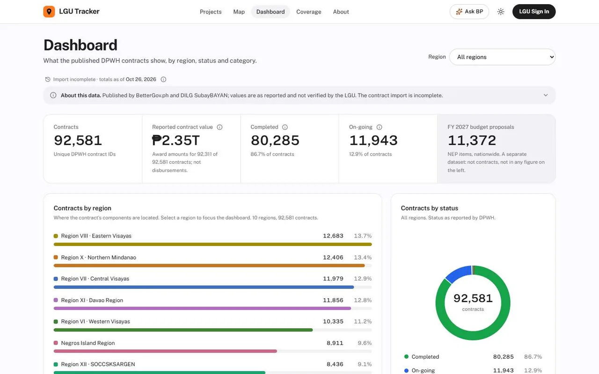
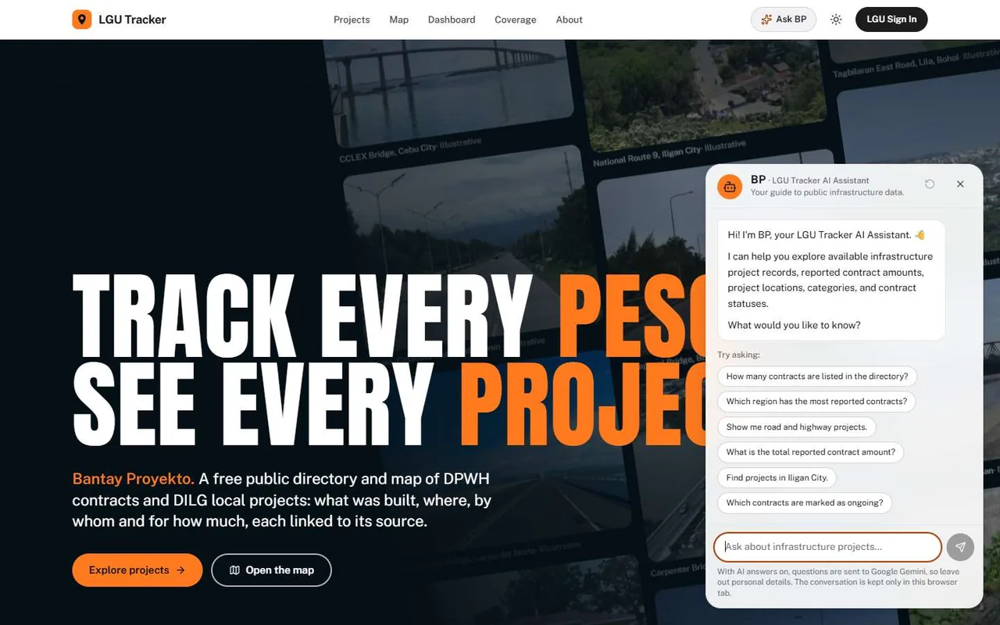
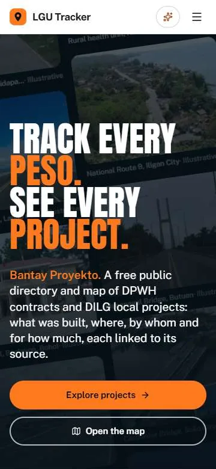

<p align="center">
  <picture>
    <source media="(prefers-color-scheme: dark)" srcset="public/brand/lockup-horizontal-on-dark.png">
    
  </picture>
</p>

# 🏗️ LGU Tracker

### *Bantay Proyekto, Gabay sa Progreso.* 🇵🇭

> 🚧 **Under active development.** Features and data are changing; see [Project status](#-project-status).

**LGU Tracker** is a free public directory and map of Philippine infrastructure projects: DPWH contracts and
DILG-reported local government projects. For each project it shows what was built, where, by whom and for how
much, and links back to where the record was published.

<picture>
  <source media="(prefers-color-scheme: dark)" srcset="docs/images/landing-dark.webp">
  
</picture>

---

## ✨ Features

### Landing page with live stats
Record counts, a region breakdown and a dot map of contract locations, read live from cached aggregates in the
database.
On a first visit, an intro animation counts up from 0 to 100%.



### Project directory
One searchable list of about 145,000 records with an **All / DPWH / DILG** agency switch, DILG categories, filters, sort,
and grid or table views.



### Project map
- **DPWH layer**: contracts at the coordinates DPWH reports. Filter by region, category and status. In view, it
  shows the largest 1,000 contracts.
- **LGU layer (DILG SubayBAYAN)**: 41,194 projects in clustered markers (supercluster), with category chips and
  source, region, province, city, year and status filters.
- **Approximate locations**: SubayBAYAN has no coordinates, so each project sits at the centre of its barangay,
  city or province. The panel says which one. An *Approximate locations* toggle shows or hides projects placed at a
  city or province centre.
- **Street View cat**: drag it onto the map to see the street there.





### Jump to a project by SubayBAYAN code
`/projects/map?code=FALGU-26-10-13-01-000-1` opens the LGU layer and zooms to that project. If several projects
share a code, it lists them all.



### Project detail pages
Every DPWH contract, NEP item and DILG project has its own page with the reported fields and a link to its source
(for BetterGov.ph data, the exact dataset file and revision).

### Dashboard
DPWH contracts by region, status, category and year, with a region filter. FY 2027 NEP proposals are counted
separately.



### Ask BP assistant
A chat assistant for questions about the directory, built on Groq tool calling (free tier). The model never writes SQL.
It can only call two read-only tools, and the counts in its answers come from the database. See
[`docs/BP_ASSISTANT.md`](docs/BP_ASSISTANT.md).



### Report a concern
Signed-in members can report a problem with any DPWH, NEP or DILG project, from the project's page or from
`/report?code=...`. Reports can carry photos from the camera or album; they are compressed in the browser and kept
in a private storage bucket. Members follow their reports under **My reports**.

### Staff report queue and inbox
LGU staff work through reports in a queue (open, not opened, resolved, closed) and move each one through
acknowledged → in review → resolved or dismissed. Reporters and staff get updates in an **Inbox**.

### Accounts, roles and profiles
Sign-in and sign-up (Supabase Auth) with four roles: **Super Admin, Admin, Government Employee and Citizen**.
Administrators approve requested roles on the **Users and roles** page. Every page and server action checks the role
again, behind Row Level Security. Members can edit their profile: name, job title, and a cropped photo or a free
drawn avatar.

### Bantay Community (preview)
Discussion threads with voting, comments, sort tabs and a composer, plus a reviews section on the landing page.
For now these are **sample discussions by fictional people**, and what you post is saved in your browser only.

### Dark mode and mobile
Light, dark or system theme, with layouts down to 360 px wide.



---

## 📚 Data sources

| Data | Source | Retrieved | License / terms |
|---|---|---|---|
| DPWH contracts (Visayas and Mindanao) | DPWH Transparency Portal via [BetterGov.ph](https://huggingface.co/datasets/bettergovph/dpwh-transparency-data) | Oct 26, 2026 (import incomplete) | CC0 1.0 |
| DPWH FY 2027 NEP proposals (nationwide, directory only, no coordinates) | [BetterGov.ph](https://huggingface.co/datasets/bettergovph/dpwh-nep-2027) | with the DPWH data | Not stated; the NEP is a public government document |
| LGU projects: Locally Funded Projects (LGSF) | [DILG SubayBAYAN (RBME)](https://subaybayan.dilg.gov.ph/rbme/projects/index?type=lgsf) | Oct 31, 2026 (Excel export snapshot) | Public government records (DILG) |
| LGU projects: LIME 20% Development Fund (RLIP) | [DILG SubayBAYAN (RBME)](https://subaybayan.dilg.gov.ph/rbme/projects/index?type=rlip) | Oct 31, 2026 (Excel export snapshot) | Public government records (DILG) |
| Boundaries (centroids for LGU projects) | NAMRIA / PSA via [OCHA COD-AB](https://data.humdata.org/dataset/cod-ab-phl), packaged by [faeldon/philippines-json-maps](https://github.com/faeldon/philippines-json-maps) v1.1.0 (PSGC 3Q 2026) | pinned by SHA-256 | CC BY-IGO (packaging: MIT) |
| Base map | © [OpenStreetMap](https://www.openstreetmap.org/copyright) contributors | live tiles | ODbL |

All values are shown as each source published them; the LGU has not verified them. Photo credits and licenses
are on the app's `/credits` page ([source](src/app/credits/page.tsx)).

---

## 🛠️ Tech stack

| Technology | Purpose |
|---|---|
| Next.js 16 (App Router) · React 19 · TypeScript | Web app |
| Tailwind CSS v4 | Styling, light and dark themes |
| Supabase (Postgres + Row Level Security) | Database, auth, public read access |
| Leaflet + supercluster | Maps and marker clustering |
| motion | Landing page animation |
| Groq API (plain `fetch`, no SDK) | Ask BP assistant |
| Vercel | Hosting |

---

## 🚀 Getting started

**Prerequisites:** Node.js 22 or later, and a Supabase project with the migrations in `supabase/migrations`
applied (`supabase db push`).

```bash
git clone https://github.com/sirikitmac/lgu-tracker.git
cd lgu-tracker
npm install
cp .env.example .env.local   # then fill in the values
npm run dev                  # http://localhost:3000
```

`.env.example` explains every variable. The main ones:

| Variable | Needed for |
|---|---|
| `NEXT_PUBLIC_SUPABASE_URL`, `NEXT_PUBLIC_SUPABASE_PUBLISHABLE_KEY` (or `..._ANON_KEY`) | Reading data |
| `SUPABASE_SECRET_KEY` | Server-only: data sync and import scripts |
| `CRON_SECRET` | Server-only: the scheduled sync route |
| `GROQ_API_KEY` (optional `GROQ_MODEL`, `GROQ_FALLBACK_MODEL`) | Server-only: Ask BP (without it, dev shows a labelled non-AI preview) |
| `GOOGLE_MAPS_API_KEY`, `NEXT_PUBLIC_GOOGLE_MAPS_EMBED_KEY` | Optional: in-map Street View |

Never commit `.env.local` or put a secret key in a `NEXT_PUBLIC_` variable.

```bash
npm test          # unit tests (DPWH, BetterGov, BP, SubayBAYAN)
npm run test:db   # database tests against an in-memory Postgres (PGlite)
npm run lint      # TypeScript type check (tsc --noEmit)
npm run build     # production build
```

### Data pipelines

- **DPWH:** `npm run dpwh:sync`. Setup and the Vercel cron are in [`docs/DPWH_DEPLOYMENT.md`](docs/DPWH_DEPLOYMENT.md).
- **DILG SubayBAYAN:** a one-time Excel export, since the portal needs a sign-in. The app never contacts the portal.

```bash
npm run subaybayan:build    # Excel → normalized, categorized, located rows + docs/subaybayan/report.md
npm run subaybayan:dedupe   # flag possible DPWH duplicates (read-only)
npm run subaybayan:import -- --dry-run   # preview; then --limit 100; then no flags for everything
```

- `build` reads `<source>/Locally_Funded_Projects/*.xlsx` and `<source>/LIME_20DF/*.xlsx`. `<source>` defaults to
  `~/Downloads/SubayBayan_RBME`; change it with `SUBAYBAYAN_SOURCE_DIR` or `--source`. Boundaries are cached in
  `.cache/subaybayan` and checked by SHA-256.
- `import` needs migration `20261103000100` and `SUPABASE_SECRET_KEY`. It upserts in batches of 1,000 and skips
  unchanged rows. It stops before the database passes `SYNC_STORAGE_BUDGET_MB` (default 400).
- Categories (infrastructure, community, health and social, environment, disaster) are **LGU Tracker's own keyword
  classification**, not DILG's. Where a reported total cost is over 20× the row's own contract amount or subsidy,
  the map shows the smaller amount and keeps the original in `total_cost_reported`.
- Possible DPWH duplicates go into `subaybayan_dpwh_matches` as review flags. Records are never merged.
- Figures and known gaps: [`docs/subaybayan/report.md`](docs/subaybayan/report.md) ·
  [`docs/subaybayan/duplicates.md`](docs/subaybayan/duplicates.md).

---

## 🗂️ Project structure

```
src/
  app/            routes: / (landing), /projects, /projects/map, /projects/dashboard,
                  /projects/[contractId], /credits, /login, /register, /dashboard, /report,
                  /community, (app)/ (profile, my-reports, reports, inbox, users), api/
  components/     landing/, dpwh/, subaybayan/, map/, bp/, reports/, community/, layout/, dashboard/, ui/
  lib/            supabase/, integrations/ (dpwh, bettergov), subaybayan/, bp/, auth/, reports/,
                  community/, actions/
scripts/          dpwh-sync, bettergov-sync, subaybayan/ (build, dedupe, import)
supabase/         migrations/, seed.sql
tests/            dpwh/, bettergov/, bp/, subaybayan/, db/
docs/             BP_ASSISTANT.md, DPWH_DEPLOYMENT.md, subaybayan/, images/
```

---

## ✅ What works today

- Landing page with live stats, coverage map and intro animation
- Project directory of ~145,000 records (DPWH contracts, FY 2027 NEP, DILG SubayBAYAN) with search, filters and sort
- Project map with DPWH and LGU layers, clustering, approximate-location toggle, `?code=` jump and Street View cat
- Project detail pages linked to their sources
- Public dashboard of DPWH contracts by region, status, category and year
- Ask BP chat assistant on Groq, answering from the database through two read-only tools
- Reporting a concern with photos, My reports, staff report queue and Inbox notifications
- Accounts with four roles, role approval by administrators, and a profile editor with photo or avatar
- Bantay Community and landing reviews (sample content only)
- Light/dark theme and mobile layouts down to 360 px

## 🛣️ Still to be added

Planned, or partly built but not working end to end yet:

- 🔄 **Automated weekly DPWH sync.** The cron route and schedule are written, but it has not run in production yet,
  and the first import is still incomplete (92,581 rows; Visayas and Mindanao only).
- 🗣️ **Real Bantay Community.** Posts, comments and votes still live in the browser; they need database tables and
  moderation before real people can use them.
- 👥 **Staff monitoring workspace with live data.** `/dashboard` is staff-only, but still falls back to sample
  project data.
- 💬 **Public feedback on projects.** The database table and server action exist; there is no form yet.
- 🔍 **Review tool for possible DPWH–DILG duplicates.** The flags are stored; there is no review screen.
- 📍 **Exact barangay-level locations** from geotagged photos, with the owners' permission.
- ⚡ **Faster directory sorts.** Some non-default sorts time out on the full dataset.
- 🗓️ **Scheduled SubayBAYAN refresh.**
- 🤖 **Ask BP live check.** Needs `GROQ_API_KEY` set on the deployment.

---

## 📌 Project status

🚧 **Under development.** Features and data may change. The data is a snapshot from the dates above, not a live
feed. LGU Tracker is a student project, not an official government website.

---

## 👥 Contributing

Bug reports, suggestions and pull requests are welcome. Work on a feature branch, run `npm test`, `npm run lint`
and `npm run build` before opening a PR, and talk to the maintainers before making large changes.

**CCC181 Final Project by Team BB (BeyondBoard).**

---

**LGU Tracker — Bantay Proyekto, Gabay sa Progreso.** 🇵🇭
